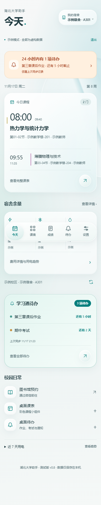
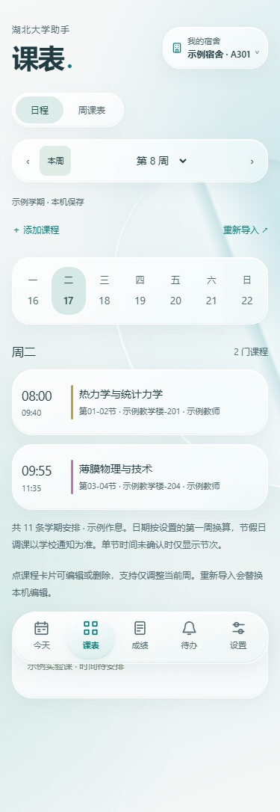
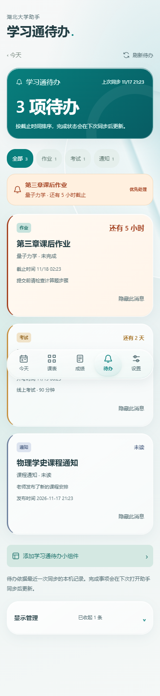
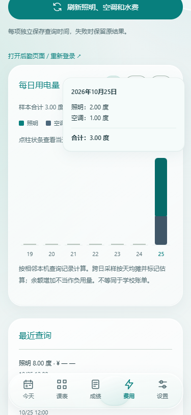
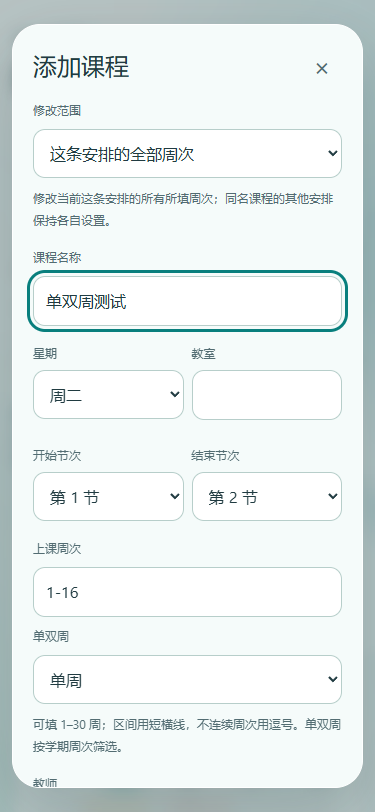

# 湖北大学助手 · 测试版 v0.8

面向湖北大学学生的第三方 Android 校园工具，把课表、宿舍余额、成绩和学习通待办放在一个入口。

个人开发，与湖北大学、超星及相关服务平台无官方隶属关系。目前为测试版，学校或平台页面变化可能导致部分功能失效。

## 下载

进入 [测试版 v0.8 下载页](https://github.com/Light-dark-max/hubu-assistant/releases/tag/v0.8-beta)，下载 `湖北大学助手-测试版-v0.8.apk`。

支持 Android 6.0 及以上，暂不支持 iOS。安装前请核对来源和校验值；已有用户覆盖安装前不要卸载旧版，以免丢失本机数据。自行编译的安装包与发布包签名可能不同，无法直接覆盖。

## 功能

- **课表**：导入学期课表，支持日程与整周视图、添加/编辑/删除课程、修改教室和节次、自选课程颜色，以及每周/单周/双周。
- **宿舍余额**：查询照明、空调、水费；成功查询记录可离线查看，并据相邻记录估算用电趋势。
- **成绩**：按学期查询成绩，计算非公选课加权均分；不把文字成绩擅自换算为百分制。
- **学习通待办**：汇总作业、考试与通知，支持本机隐藏/恢复和自定义应用内提醒时间。
- **桌面组件**：今日课表、学习通待办，显示本机课表或最近一次同步缓存。
- **示例模式**：不登录也可体验界面；示例数据与真实数据分开。

## 界面预览

以下均为本地测试图片及示例数据。部分沿用早期版本，导航和版本标识可能略有不同。

| 首页 | 课表 | 学习通待办 |
| --- | --- | --- |
|  |  |  |

| 用电详情 | 单双周编辑 |
| --- | --- |
|  |  |

登录说明：学习通可以长期保持登录，无需每次重新登录。学校账号的登录状态只能短暂保留；登录一次学校账号后，在登录有效期间内即可查询相关学校信息，无需逐项重复登录，失效后需要重新登录。

## 第一次使用

1. 安装后可先点击「先看看示例效果」，体验完成后退出示例模式。
2. 在设置中填写学期第一周的周一日期，以学校校历为准。
3. 进入课表导入，在官方教务页面登录，选择需要的学期和「全部」周次，点击顶部导入。之后可以离线查看与编辑。
4. 修改单双周：点击课程，将修改范围切换为「这条安排的全部周次」，填写范围如 `1-16`，选择每周、单周或双周。单双周按学期周次计算。
5. 查询费用或成绩时按页面提示在对应官方系统登录；学习通在设置中登录后点击「已登录，开始同步」。
6. 桌面小组件从应用入口或系统桌面组件列表添加。

重新导入课表会替换本机课程与手动编辑。节假日和临时调课请以学校通知为准。

## 隐私与联网

没有自建业务服务器。查询由设备访问学校、超星及相应服务，结果缓存于本机；首次加载官方页面及使用查询功能需要联网。

登录在对应官方 WebView 页面完成，助手不读取或自行保存密码输入框内容。WebView 会保留本机 Cookie、网页存储和登录会话；学习通同步使用相应会话，不等于不保存登录状态。详情见 [隐私说明](PRIVACY.md)。

学习通进入前台时同步，进入后台取消同步；课表与待办组件读取本机缓存。提醒目前仅在应用内显示，关闭应用后没有系统推送或闹钟提醒。

## 已知限制

- 测试与构建通过，不代表各机型、各账号的真实登录、同步和桌面组件都完成实机验收。
- 学校系统和学习通页面、会话或接口变化可能造成失败；重要日期和成绩请核对官方页面。
- 用电趋势根据查询记录估算，跨日采样不是逐日账单；无法识别两次采样间同时充值与耗电。
- 系统桌面可能延迟组件更新。暂不提供后台待办联网、应用关闭后的提醒或自动更新安装。

## 本地预览与构建

技术栈：Java + Android WebView + 原生 HTML/CSS/JavaScript。包名 `com.hubu.energy`。

浏览器预览（只展示界面，不查询学校）：

```sh
node preview-server.cjs
```

打开 `http://127.0.0.1:8767/?demo=1`。

Android 构建需要 JDK 17、Android SDK 35，Gradle Wrapper 为 8.7。配置 `ANDROID_HOME`，或在不提交的 `local.properties` 中配置 SDK 路径。

```powershell
.\gradlew.bat :app:assembleDebug :app:lintDebug
```

macOS/Linux：`sh gradlew :app:assembleDebug :app:lintDebug`。输出为 `app/build/outputs/apk/debug/app-debug.apk`。首次构建需要下载依赖。

离线逻辑测试不需要额外 Node 依赖：

```sh
npm test
```

浏览器回归使用 Playwright，安装依赖与 Chromium 后运行；也可通过 `BROWSER_PATH` 指向本机浏览器：

```sh
npm install
npx playwright install chromium
npm run test:ui
```

测试只访问本地。公开课表样本为人工构造，不包含个人课表页面。详见 [测试版发布说明](docs/RELEASE-v0.8.md)。

## 反馈与来源

请在本仓库 Issues 中附上手机型号、Android 版本、应用版本、复现步骤和脱敏截图。不要公开账号密码、Cookie、令牌、完整学号或手机号。

学习通接入参考、第三方组件及许可状态见 [THIRD_PARTY_NOTICES.md](THIRD_PARTY_NOTICES.md)。目前公开源码供查看，尚未授予项目整体的复制、修改和再分发许可；第三方组件按各自许可证使用。项目整体开源许可证待确认。
